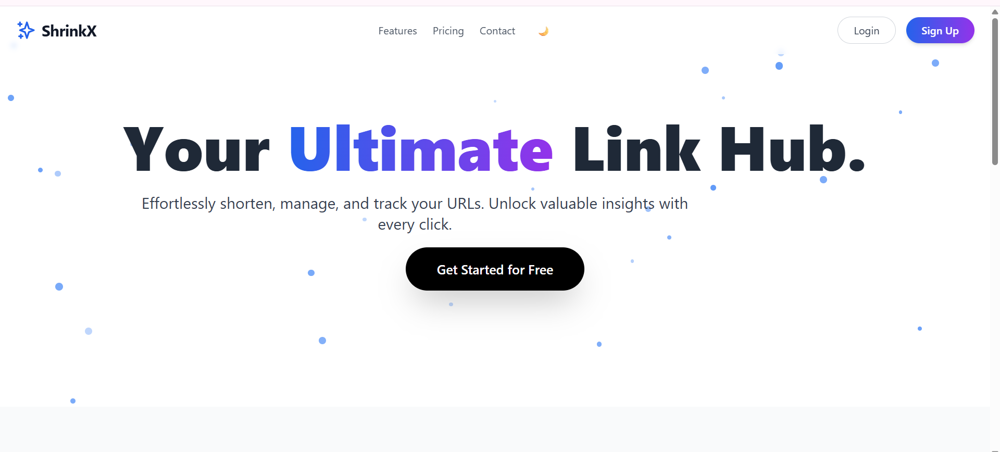
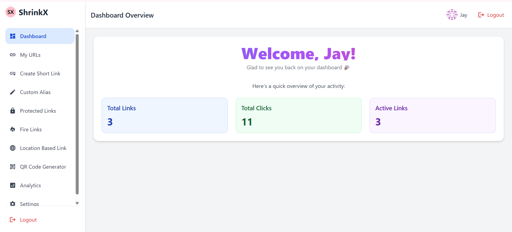
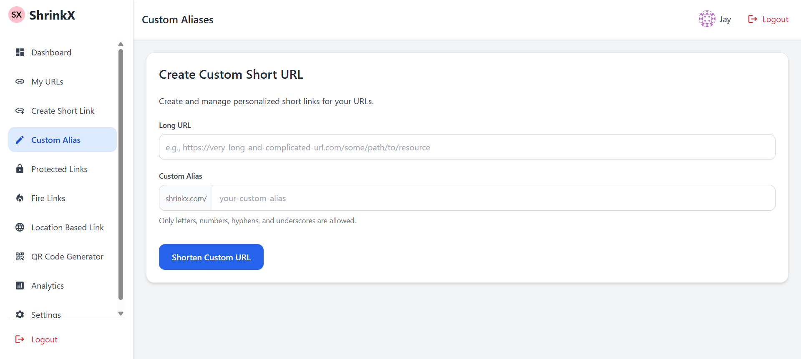
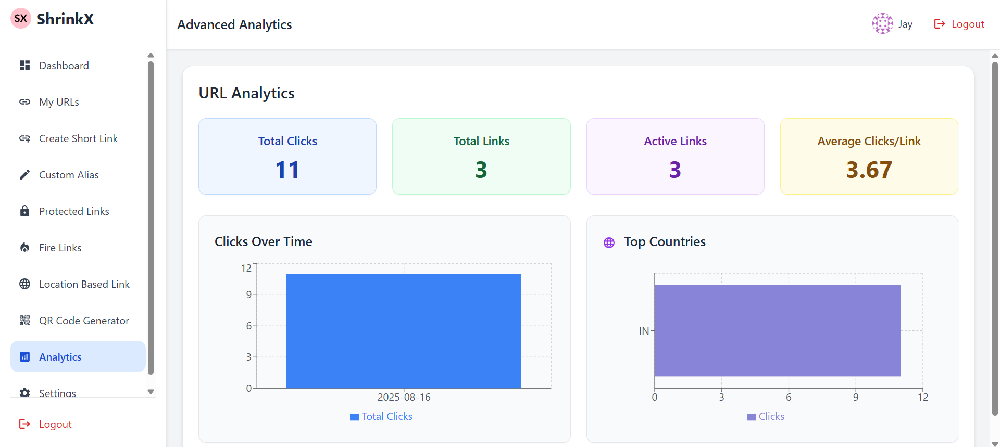
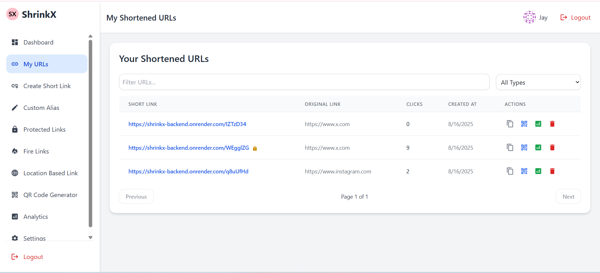

<h1 align="center">🚀 ShrinkX</h1>  

  
  <b>ShrinkX is an advanced URL shortener built with the MERN stack. It goes beyond just shortening links — ShrinkX provides analytics, QR code generation, password-protected links, fire links (one-time use), and a modern responsive dashboard for managing all your URLs.</b>  

  

---

## 📸 Screenshots  

  
  <b>🏠 Home Page</b>   
    

  

  
  <b>📂 Dashboard</b>   
    

  

  
  <b>✂️ Shorten URL Page</b>   
    

  

  
  <b>📊 Analytics Page</b>   
    

  

  
  <b>🔗 My URLs Page</b>   
    

  

## ✨ Features  

- 🔗 **Custom Short Links** – Generate short, memorable URLs  
- 🔐 **Protected Links** – Add passwords to restrict access  
- 🔥 **Fire Links** – Auto-expire after one visit  
- 📊 **Analytics Dashboard** – Track clicks, location, device & referrer data  
- 📱 **Responsive UI** – Works seamlessly on desktop & mobile  
- 🖼 **QR Code Generation** – Instantly generate & download QR codes  
- 📂 **Link Management** – Edit, delete & organize links easily  
- ⚡ **Authentication** – Secure login & signup with JWT  

---

## 🛠️ Tech Stack  

| Layer        | Technologies |
|--------------|--------------|
| **Frontend** | React.js, TailwindCSS, ShadCN UI |
| **Backend**  | Node.js, Express.js |
| **Database** | MongoDB (Mongoose ODM) |
| **Auth**     | JWT (JSON Web Tokens), bcrypt.js |
| **Deploy**   | Render (Frontend & Backend), MongoDB Atlas |

---
🚀 Installation & Setup

Clone the repo:

git clone https://github.com/your-username/shrinkx.git
cd shrinkx

**Backend Setup**
cd backend
npm install
npm run dev

*Create a .env file inside backend/ with*:

-PORT=3000
-MONGO_URI=your_mongodb_uri
-JWT_SECRET=your_jwt_secret
-CLIENT_URL=http://localhost:5173

**Frontend Setup**
cd frontend
npm install
npm run dev

Now open 👉 http://localhost:5173

---
**🌍 Deployment**
Frontend: Render
Backend: Render
Database: MongoDB Atlas

---
**🤝 Contributing**

Contributions are welcome! Fork the repo and submit a PR.

---
**📜 License**

MIT License © 2025 [Patel Jaykumar Rakeshbhai]

⚡ ShrinkX — Shrink smart, share faster.

